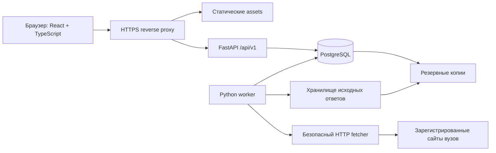

# Целевая архитектура MVP

Это проектная схема. Реально существующие модули перечислены в STATE.md. Будущие таблицы и endpoints ниже ещё не созданы.

## 1. Контур исполнения

API обслуживает запросы быстро; скачивание списков и разбор выполняются worker. Polling frontend получает готовое состояние. WebSocket не требуется для первого MVP. Один снимок списка обслуживает все подписки на эту конкурсную группу; нельзя скачивать один список отдельно для каждого абитуриента.

## 2. Ответственность модулей

| Модуль | Отвечает за | Не должен делать |
| --- | --- | --- |
| `frontend/src/pages`, `frontend/src/components` | Взаимодействие и отображение состояния | Самостоятельно придумывать правила приёма |
| `frontend/src/lib/api` | Типизированный контракт, ошибки, отмена/дедупликация запросов | Скрытно повторять запись после неизвестного результата |
| API domain | Расчёт, ownership, правила работы с данными | Выполнять сетевой парсинг внутри HTTP-запроса |
| Source registry | Домены, сезоны, адаптеры, интервалы, допустимые форматы | Обещать совместимость по одному сходству HTML |
| Fetcher | Таймауты, лимиты, redirects, сеть и HTTP-кэш | Обходить CAPTCHA/авторизацию, читать внутренние адреса |
| Adapter | Преобразование одного известного формата | Молча заменять неизвестные значения нулями |
| Validator | Проверка полноты, схемы, уникальности и группы | Публиковать неполный снимок как свежий |
| Worker | Захват задания, повтор, публикация снимка, пересчёт | Запускать бесконечные агрессивные повторы |
| Explain | Формирование понятного текста из facts | Менять числовой результат алгоритма |

## 3. Модель данных

### Существующие сущности

`BrowserSession(token_hash, expires_at)`, `Watch(owner_hash, university, title, source_url, created_at)`, `Snapshot(watch_id, captured_at, rank, seats, excluded, no_consent, source_kind, model_version)`.

Они представляют ручной прототип. Автоматические списки нельзя хранить как независимую копию всех строк в каждом Watch.

### Целевые сущности

В T015 добавлен модуль `backend/app/admissions.py`: University, Campaign, CompetitionGroup, Source, SourceSnapshot, CandidateEntry, PublishedSnapshot, Subscription, Assessment. Это схема хранения; endpoints автоматического режима и импорт ещё не реализованы. Существующий Watch/Snapshot остаётся ручным режимом. Общий снимок не копируется на владельца, Subscription хранит только ссылку на группу и публичный код в её области.

Составные FK запрещают привязку снимка к другой группе/источнику и смешивание группы подписки с группой оценки. Неизвестные seats/consent/priority остаются null. Публикуемый указатель отделён от неизменяемого снимка; атомарность публикации и семантическая валидация состава реализуются отдельно в T033. ImportRun/RefreshJob/ChangeEvent пока плановые.

| Сущность | Ключ и существенные поля | Инвариант |
| --- | --- | --- |
| University | stable id, официальное название, регион, реестровый ID, parent/branch | Филиал и головной вуз не сливаются по похожему названию |
| AdmissionCampaign | university/branch + year + level | Данные разных сезонов не смешиваются |
| CompetitionGroup | campaign + official group id, форма, финансирование, категория конкурса | Бюджет общего конкурса не подменяется суммой всех мест |
| Source | domain, list URL, adapter version, access policy, cadence | Активный fetch только после проверки источника |
| ImportRun | source, status, started/finished, http status, error code, retry count | Любая попытка видна, даже если публикации не было |
| SourceSnapshot | source/group, raw hash, fetched_at, source_updated_at, validation status | Неизменяемая версия; latest переключается атомарно |
| CandidateEntry | snapshot + source candidate id, official rank, score/order, consent, priority, participation | Уникальность в пределах снимка и области ID; null не false |
| Watch | owner, group, candidate reference или manual values | Ручной и автоматический режимы имеют явный тип |
| Assessment | watch + snapshot + rule version, outputs, assumptions, quality | Результат воспроизводим по ссылкам на входы |
| ChangeEvent | watch, old/new assessment, reason, seen_at | Повтор задания не создаёт повторное событие |
| RefreshJob | source/group, due_at, lease_until, attempts, idempotency key | Только один владелец активного lease |

Сырой ответ хранится ограниченное время в закрытом volume/object storage; в БД — hash, locator, размер, тип и provenance. Срок и размер устанавливаются до запуска; в Git только обезличенные fixtures. Нормализованные поля сохраняют происхождение и версию parser.

### Времена

- `fetched_at` — когда сервис успешно получил ответ.
- `source_updated_at` — дата публикации в самом источнике, либо null, если её нет.
- `parsed_at` — момент обработки.
- `captured_at` — момент ручного сохранения.
- `assessed_at` — момент расчёта.

Свежее скачивание старого документа не делает его содержимое свежим. Сбой очередной попытки не меняет время последнего успеха. Хранить UTC с timezone, отображать с понятным часовым поясом.

## 4. API

### Уже описанные в коде маршруты — требуют тестов

`GET /api/health`, `POST /api/v1/calculate`, `POST /api/v1/session`, `GET/POST /api/v1/watches`, `GET/DELETE /api/v1/watches/{id}`, `POST /api/v1/watches/{id}/snapshots`.

### Планируемые контракты

- Каталог `/universities`, `/campaigns`, `/groups`: пагинация, фильтры, coverage и season.
- Поиск строки `/groups/{id}/candidates/search`: ограничение частоты и минимальный ответ без раскрытия чужих данных.
- `/watches/{id}/assessment`: result, source snapshot, rulesVersion, dataQuality, freshness, assumptions, blockers.
- `/watches/{id}/history`: стабильная пагинация и обе даты сравнения.
- `/changes`: события только владельца; подтверждение прочтения идемпотентно.
- Диагностика `/sources/{id}/status` без секретов; административные изменения только с отдельной авторизацией либо локальным CLI.

DTO получают `mode: manual|automatic|archive`, `status: within_capacity|conditional|outside_capacity|insufficient_data|stale|unsupported`, `source`, `observedAt`, `ruleVersion`, `explanationFacts`. Текущий `safe` — внутреннее имя прототипа; не делать из него обещание безопасности поступления.

Ошибки: стабильный `code`, короткий пользовательский `message`, необязательные field errors и request id. 401, 403, 404, 409, 422, 429, 503 проверяются отдельно. Чужой ID не должен раскрывать наличие чужого Watch. OpenAPI синхронизируется с frontend; TypeScript-типы не заменяют проверку данных на границе.

## 5. Pipeline обновления

1. Планировщик выбирает активные источники с due time.
2. Worker атомарно берёт lease, соблюдая общий лимит и лимит домена.
3. Fetcher проверяет URL/DNS/redirect, размер, время и тип ответа.
4. Ответ сохраняется с hash; ETag/Last-Modified используются только при корректной поддержке источником.
5. Adapter извлекает строки, группы, места и дату, сохраняя unknown.
6. Validator проверяет schema, полноту, дубли, сезон, непротиворечивость. Подозрительное изменение отправляется в quarantine.
7. В транзакции создаётся снимок и переключается latest. Неудача не затрагивает previous valid.
8. Модель рассчитывает подписки на эту группу. Повторная обработка не дублирует assessment/change.
9. Создаются события изменений и метрики качества.
10. Lease завершается; при падении процесса следующий worker забирает просроченное задание безопасно.

Плановый начальный интервал 15–30 минут — гипотеза для пилота, подчинённая ограничениям сайта и бюджету. Перед дедлайнами интервал можно менять по измерениям и разрешённой нагрузке. Он не означает гарантированного обновления самим вузом.

## 6. Производительность и рост

До нагрузочного теста зафиксировать размер набора: число групп, строк и подписок, частоту обновления. Индексы: owner watches, group/time snapshots, snapshot/candidate lookup, due/lease jobs. Избегать N+1 при списке карточек; существующий `watch_read` с отдельным запросом latest на каждую карточку — кандидат на измерение и улучшение.

Проверять worst case одного большого списка, не только много маленьких запросов. Число worker увеличивается без дублирования публикаций. Redis, отдельные очереди и разделение сервисов добавлять по метрикам, сохраняя доменный контракт.

## 7. Развёртывание

Один origin: Caddy отдаёт сборку React и проксирует `/api`; отдельные контейнеры API, worker, PostgreSQL. API и БД не публикуются наружу напрямую. Миграция — отдельный шаг перед стартом новой версии. Секреты поступают из окружения, `.env` не коммитится.

Production требует HTTPS, secure cookies, резервных копий и мониторинга. Frontend собирается в `frontend/dist/`. Неиспользуемый конфиг Sites удалён при очистке (ADR-017); решение о площадке должно охватывать весь Python-стек.
