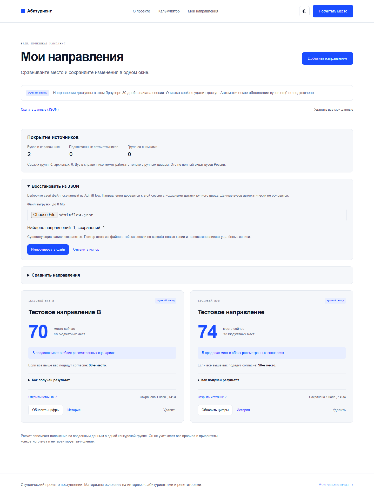

# AdmitFlow — состояние MVP

**1 ноября 2026 · день 1 из 30 · ориентировочно 40% готовности автоматического MVP.**

`████████░░░░░░░░░░░░ 40%`

Это инженерная оценка объёма оставшейся работы, не измеренная точность и не обещание срока. В реестре закрыты100 из153 задач, но задачи имеют разный вес. Ни один релизный gate ещё не закрыт полностью. B07 завершил15 шагов импорта, формы, сессии и проверок ручного кабинета; главное ограничение — реальные исходные списки, PostgreSQL и доступ к рабочему окружению. Оценка осталась40%: надёжность улучшена, реальные автоисточники ещё не подключены.

| Часть проекта | Сейчас |
| --- | --- |
| Лендинг, калькулятор, светлая/тёмная темы | Работают; точная сверка макетов и локальные шрифты впереди |
| Ручной кабинет | CRUD, история страницами, сравнение, объяснение, экспорт и подтверждённый импорт JSON, сессии, клавиатура и безопасные повторы |
| Каталог | 2 исследованных вуза; блок покрытия показывает отдельно 0 автоисточников и 0 опубликованных групп |
| Сервер и БД | Alembic 0001–0004, контракты и ограничения; сохранность старых данных проверена на SQLite, PostgreSQL ещё нужен |
| Источники | 5 кандидатов исследованы; контур и capture CLI готовы, реальная загрузка original bytes пока блокируется; аттестованных адаптеров — 0 |
| Автоматическое обновление | Очередь, worker, атомарная публикация, повторы и диагностика проверены на синтетических данных; реальные циклы и assessments впереди |
| Эксплуатация | HTTP limits/Host/Origin, безопасные журналы, liveness/readiness, raw retention и SQLite backup/restore проверены локально |
| Выпуск | Docker/CI подготовлены, PostgreSQL/полный запуск/публичное размещение и production backup не подтверждены |

S058: **200 backend-тестов прошли, 7 PostgreSQL-проверок пропущены** из-за недоступного окружения. Последний frontend-прогон S057: 67 тестов, production build и 32 Chromium прошли; frontend с тех пор не менялся. Исправлена проверка PostgreSQL CHECK при запуске старой БД; **T103 остаётся без галочки до реальной проверки запуска**. Инструкция пересборки без удаления данных — RUNBOOK.md. Количество тестов не заменяет проверку реальных конкурсных списков.

S059: сайт на localhost:8080 отвечает; отдельный HTTP smoke прошёл **15 проверок**, включая запись/историю/экспорт и изоляцию сессий. Тестовые данные удалены. Это подтверждает работу API; T103 остаётся review до проверки старой PG-схемы и сохранности прежних данных. Воспроизводимая команда — backend/tests/runtime_smoke.py, отчёт — [t103-docker-smoke.json](evidence/t103-docker-smoke.json). Новые продуктовые функции в этом шаге не добавлялись.

## Подход B07 — 15 из 15

Финальный S112: **276 backend passed/7 PostgreSQL skipped,87 frontend passed, build успешен,53 Chromium passed**. В том числе проверены три настоящих перезапуска процесса API на временной SQLite-базе. PostgreSQL и контейнерные данные этим не проверены.

- [x] T139 — строгий JSON файла: без дублей ключей, бесконечных чисел и чрезмерной вложенности.
- [x] T140 — отклонить повреждённый UTF-8, сохранить корректную кириллицу и BOM.
- [x] T141 — отмена медленного чтения файла без подмены нового предпросмотра.
- [x] T142 — Unicode-лимиты формы и справочника совпадают с API.
- [x] T143 — отменять ненужные запросы поиска вузов.
- [x] T144 — выбор вуза стрелками, Enter и Escape.
- [x] T145 — отменять ожидание private GET без поломки общей сессии.
- [x] T146 — освобождать непрочитанные тела старых ответов и401.
- [x] T147 — защита от ухода по ссылкам во время сохранения.
- [x] T148 — форма не отправляется одновременно с импортом, поля остаются.
- [x] T149 — проверять границы UTC после применения часового пояса.
- [x] T150 — понятный отказ экспорта при откате часов без изменения истории.
- [x] T151 — исправлен overflow открытой длинной формы;320px и обе темы проверены.
- [x] T152 — печать выбранной записи с источником и ограничениями, проверен A4 PDF.
- [x] T153 — история, ownership и повторы сохраняются после перезапуска API.

Посмотреть: [текущий ручной кабинет](http://127.0.0.1:5186/tracker), [мобильный пример](evidence/manual-mobile-b07.png), [печатный отчёт](evidence/manual-report.png). Пример введён вручную; тестовая сессия удалена после снимка. Preview требует живых локальных процессов; Docker8080 не пересобирался.

## Подход B06 — 20 из 20

Финальный S096: **269 backend passed/7 PostgreSQL skipped,77 frontend passed, build успешен,46 Chromium passed** на текущем API8005. Первый browser run остановил один сценарий из-за transient module-load failure; без ослабления проверок сценарий прошёл3 отдельных повтора, затем полный набор46/46. Настоящие PG migration-тесты остаются пропущенными.

- [x] T119 — отклонить управляющие символы в названиях и ссылках.
- [x] T120 — отклонить неоднозначный JSON до записи данных.
- [x] T121 — ограничить и обезличить ошибки валидации.
- [x] T122 — не запускать production с ошибочными настройками.
- [x] T123 — ограничить подключение к PostgreSQL по времени.
- [x] T124 — пакетно читать направления и экспорт без N+1 запросов.
- [x] T125 — правильно упорядочивать снимки с одинаковым временем.
- [x] T126 — принимать только явные ISO-даты с timezone.
- [x] T127 — согласовать границы дат импорта с сервером.
- [x] T128 — согласовать Unicode-порядок IDs с Python.
- [x] T129 — выявлять обрезанный ответ источника.
- [x] T130 — отклонять неоднозначные HTTP-заголовки и редиректы.
- [x] T131 — проверять ограничения и неизменяемость fetch policy.
- [x] T132 — сохранять исходный результат при сбое очистки spool.
- [x] T133 — проверять объявления адаптеров до использования registry.
- [x] T134 — применять новую политику при допустимом reenqueue.
- [x] T135 — создавать одну сессию при одновременном открытии вкладок.
- [x] T136 — отбрасывать запоздавшие ответы прежней сессии.
- [x] T137 — ограничить чтение JSON-ответа в браузере.
- [x] T138 — показать восстановление при ошибке загрузки страницы.

Новый экран восстановления (контролируемая имитация отказа модуля, фокус на заголовке):

Сохранённые данные этот экран не удаляет. Исправления не подключают вузы и не заменяют native PG/CI. Production adapters по-прежнему0, T103 review.

## Подход B05 — 15 из 15

Финальный прогон S075: **205 backend passed /7 PostgreSQL skipped,68 frontend passed, build успешен,44 Chromium passed**. После последних небольших правок дополнительно прошли сборка и4 проверки печати/истории/mobile/навигации. Preview использует явно перезапущенный текущий API8004.

- [x] T104 — поиск, фильтрация и сортировка сохранённых направлений.
- [x] T105 — сравнение любой пары загруженных сохранений.
- [x] T106 — общий размер истории и остаток лимита500.
- [x] T107 — все исходные числа, модель и точное время в истории.
- [x] T108 — печатный отчёт с источниками и допущениями.
- [x] T109 — защита черновика при удалении редактируемого направления.
- [x] T110 — фокус и Escape в подтверждениях удаления.
- [x] T111 — сохранение карточек при ошибке фонового обновления.
- [x] T112 — точная дата окончания гостевого доступа.
- [x] T113 — защита старой вкладки при сбросе доступа в другой.
- [x] T114 — пропуск навигации, фокус заголовков и title404.
- [x] T115 — таблица истории с прокруткой стрелками на телефоне.
- [x] T116 — ручное обновление кабинета с сохранением ввода формы.
- [x] T117 — названия, источники и даты в предпросмотре импорта.
- [x] T118 — readiness отклоняет несовместимую версию схемы БД.

Улучшения ручного пути не закрывают реальные адаптеры, PostgreSQL/CI или весь набор браузеров. T103 остаётся review. Число новых карточек не считается процентом автоматизации.

## Подход B04 — 10 из 10

- [x] T093 — ограничить формулировки ручным сценарием, уточнить согласия и готовность функций.
- [x] T094 — разрешить безопасный повтор импорта даже при лимите 20 направлений.
- [x] T095 — проверять реальные даты, timezone/микросекунды и порядок полной истории.
- [x] T096 — связать ошибки с полями и переводить фокус на первое неверное значение.
- [x] T097 — подтверждать потерю изменённой формы при закрытии, переключении и обычном переходе.
- [x] T098 — одинаково обрабатывать истечение доступа во всех действиях кабинета.
- [x] T099 — ограничить ожидание raw-блокировки внутри процесса общим deadline.
- [x] T100 — устранить зависание worker при частичном ответе fetch-процесса.
- [x] T101 — исключить перезапись папки при конкурентном восстановлении; запрещать запуск неполной копии.
- [x] T102 — показывать failed/expired задания в диагностике и исключать ложный fresh.

Каждый шаг — отдельный английский Conventional Commit. Исходные широкие задачи и релизные gates сохраняют критерии реальных данных и окружения. Синтетические тесты очереди не считаются автоматическим подключением вуза.

## Подход B03 — 10 из 10

- [x] T083 — capture CLI с original bytes/manifest/hash для двух закрытых целей пилота; реальный fetch отказал безопасно.
- [x] T084 — лимит размера и времени приёма API-запроса.
- [x] T085 — точные Host/Origin и явные production-настройки.
- [x] T086 — request ID, безопасные журналы и отдельные liveness/readiness.
- [x] T087 — dry-run очистки orphan raw с межпроцессной защитой публикации.
- [x] T088 — согласованная SQLite-копия с исходными файлами всех версий.
- [x] T089 — проверка/восстановление копии в новое окружение с ownership isolation.
- [x] T090 — атомарный, идемпотентный импорт ручной истории через API.
- [x] T091 — выбор, проверка и подтверждение файла в интерфейсе; безопасный повтор.
- [x] T092 — фактическое покрытие каталога/автоисточников/снимков, без выдуманного национального процента.

Capture-инструмент не считается полученным реальным fixture. SQLite-копия не считается проверкой PostgreSQL или production восстановления. T006 и T013 отмечены blocked с условиями снятия: доступный GitHub CI и оригинальные ответы списков. Следующий шаг критического пути требует этих внешних входов.

## Подход B02 — 10 из 10

- [x] T073 — таймауты запросов, отмена чтения и восстановление загрузки.
- [x] T074 — просмотр всех ручных сохранений страницами без дублей.
- [x] T075 — сравнение двух–трёх ручных направлений с датами и источниками.
- [x] T076 — строгий контракт и закрытый реестр адаптеров.
- [x] T077 — нормализация и карантин повреждённых/неполных списков.
- [x] T078 — приватное хранилище исходных ответов с проверкой SHA-256.
- [x] T079 — атомарная публикация снимков и версии парсеров без перезаписи истории.
- [x] T080 — отдельные времена, архив, свежесть и ошибки источника.
- [x] T081 — очередь, аренда задания, предел повторов и защита от старого worker.
- [x] T082 — worker once/loop и команды status/enqueue/disable; синтетический сквозной цикл.

Это десять завершённых подзадач широкого roadmap. T013/T014/T027/T029–T037 и релизные gates сохраняют требования реальных данных, аттестации и PostgreSQL. Production registry пуст; синтетический адаптер из тестов не включён в продукт.

## Подход B01 — 5 из 5

- [x] T020 — различать доступный сценарий, нехватку данных и неподдержанную модель.
- [x] T069 — показывать формулу и ограничения расчёта.
- [x] T070 — сравнивать два ручных сохранения и их входные числа.
- [x] T071 — скачивать все свои направления с полной историей в JSON.
- [x] T072 — открыть, заполнить, сохранить и закрыть форму с клавиатуры с возвратом фокуса.

Каждый шаг сохранён отдельным коммитом. Общий список с незакрытыми задачами — [CHECKLIST.md](../CHECKLIST.md).

## Что осталось до MVP

1. Получить оригинальные ответы двух источников, проверить правила/полноту и аттестовать адаптеры. Выбор сезона релизного продукта пока открыт; исследование велось на 2026, вне кампании только с пометкой архива.
2. Подключить реальные источники к готовому контуру worker/публикации, проверить циклы обновлений, реализовать поиск своей строки, автоматические assessments и объяснение реальных изменений.
3. Завершить группы/сезоны в каталоге, состояния свежести и ошибок, доступность и сверку интерфейса по макетам.
4. Проверить всё на PostgreSQL и в Docker/CI, затем backup/restore, наблюдаемость, staging и выпуск.

Вероятностный прогноз потребует исторических данных и отдельной проверки модели. Текущий калькулятор показывает условные сценарии и не гарантирует поступление.

## Как посмотреть

Проверенный preview B06: http://127.0.0.1:5185, кабинет — http://127.0.0.1:5185/tracker (API8005, схема0004, изолированная demo БД). При остановленных процессах — команды из RUNBOOK.md; обычные порты5173/8000. Через Docker: `docker compose up --build`, затем http://localhost:8080; пересборка текущего кода и PostgreSQL-миграции пока требуют подтверждения.

Скриншоты обновлены после B05: два синтетических ручных направления, срок доступа, фильтры, сравнение выбранных сохранений, полная таблица и предпросмотр импорта без POST. Покрытие2/0/0, демо-сессии удалены204. Это не реальная конкурсная группа и не подтверждение точного совпадения с макетами.

[Мобильный скриншот](evidence/preview-mobile.png)

Точная точка продолжения — [STATE.md](STATE.md), задачи — [TASKS.md](TASKS.md). Все законченные изменения сохранены отдельными английскими Conventional Commits.
