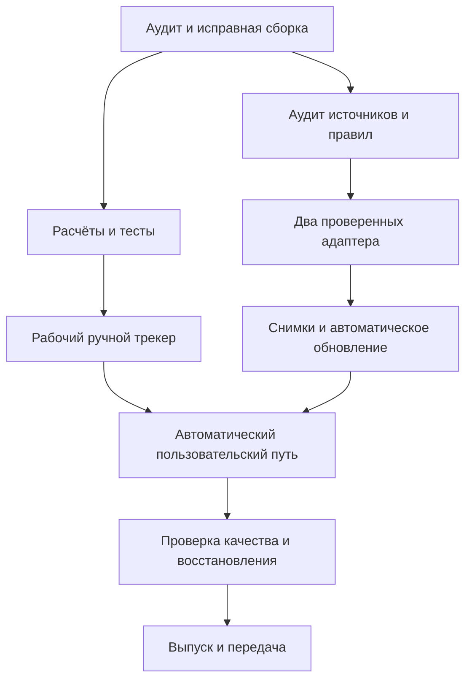

# Roadmap MVP «Абитуриент» — 30 дней

## Как пользоваться

Это основной маршрут разработки. Подробные карточки: [TASKS.md](TASKS.md). Текущее состояние: [STATE.md](STATE.md). Машиночитаемые статусы: [TASKS.json](TASKS.json). Проверка плана: `python scripts/roadmap.py --check`.

Все дни относительные: D1 — день начала исполнения согласованного цикла. Дата старта хранится в STATE.json, дата актуальности передачи отражена в STATE.md. Длительность — 30 календарных дней, включая резерв. План предполагает регулярные рабочие сессии, доступ к источникам и площадке развёртывания. Обещание «готово за месяц» не заменяет прохождение контрольных точек.

Разработка ведётся по этапам и критериям приёмки ниже. Для внешних интеграций отдельно проверяются доступы и данные, которые нельзя получить из открытых источников.

## Критический путь

Дизайн можно дорабатывать одновременно с исследованием источников, но обнаруженные риски данных решаются в первой неделе. Нельзя отложить проверку списков до последнего дня.

## Этапы и контрольные точки

| Дни | Этап | Проверяемый результат | Условие перехода |
| --- | --- | --- | --- |
| D1–D3 | E0. Стабилизация | React собирается; тестируется текущий TS-код; API имеет воспроизводимый запуск | G0: сборка и базовые тесты зелёные |
| D2–D7 | E1. Источники и правила | Паспорт источников, сохранённые образцы, границы модели и первый проверенный разбор | G1: два кандидата доступны; хотя бы один импорт воспроизводим; нет неизвестных критичных полей |
| D4–D10 | E2. Ядро продукта | Сохранение, история, сессии, типизированный API, PostgreSQL и сценарии расчёта | G2: полный ручной путь проходит E2E и тест изоляции |
| D8–D17 | E3. Автоматический сбор | Два адаптера, атомарные снимки, очередь обновления, свежесть и диагностика | G3: автоматический путь и восстановление после сбоя проверены |
| D15–D22 | E4. Объяснения и интерфейс | Поиск себя, сравнение направлений, объяснение изменений, доступность и адаптивность | G4: понятный пользовательский путь на desktop/mobile |
| D20–D27 | E5. Подготовка выпуска | Staging, HTTPS, мониторинг, нагрузочные и security-проверки, восстановление backup | G5: критерии QUALITY.md выполнены, критичных дефектов нет |
| D28–D30 | E6. Резерв и выпуск | Исправления, повторная приёмка изменённых частей, версия, инструкция и передача | G6: релиз проверен, известные ограничения опубликованы |

Этапы пересекаются по календарю за счёт чередования независимых задач, а не наличия нескольких исполнителей. Размер S ≈ небольшой законченный шаг; M ≈ рабочая сессия; L нужно разбить при выходе за одну сессию. Это относительная оценка; первые три дня дают основание пересчитать фактическую скорость.

## План по дням

| День | Основной результат | Что показать/сохранить |
| --- | --- | --- |
| D1 | Исправить текущую сборку и убрать зависимость тестов от старого dist | Лог build/test, фиксация исходного состояния |
| D2 | Воспроизводимая Python-среда, первые API-тесты; начать аудит сайтов | Health/calculation smoke, список кандидатов |
| D3 | Общий набор контрольных расчётов, CI; уточнить сезон и данные | G0, правила и неизвестные |
| D4 | Проверить документы пилотных вузов и получить реальные образцы | Датированные паспорта и fixtures |
| D5 | Модель идентичности вуз/филиал/сезон/группа; миграции | Схема и upgrade-test PostgreSQL |
| D6 | Первый минимальный разбор источника и нормализация | Сверка полей, отчёт о строках |
| D7 | Подтвердить выполнимость автоматизации, пересчитать план | G1; решение о формате beta при проблемах |
| D8 | Довести сохранение направлений, ошибки и изоляцию сессий | API-тесты ownership и expiration |
| D9 | История, поиск/выбор группы, частичные данные | Пример пользовательского пути |
| D10 | Полный ручной путь и визуальная сверка | G2, актуальные скриншоты |
| D11 | Завершить первый адаптер с негативными образцами | Контрактные тесты адаптера |
| D12 | Второй независимый источник/формат | Сверка с оригиналом |
| D13 | Хранение сырого ответа и нормализованного снимка, атомарная публикация | Тест повторного импорта и повреждённого ответа |
| D14 | Отдельный worker, дедупликация и ограничения частоты | Логи заданий, проверка двух worker-процессов |
| D15 | Метки свежести, отказ источника, карантин | Отчёт об имитированном сбое |
| D16 | Поиск абитуриента и запуск автоматического расчёта | Подтверждение строки и источника |
| D17 | Сквозная автоматическая проверка и воспроизведение архивной последовательности | G3 |
| D18 | Сравнение направлений и объяснение изменений | Before/after на одном наборе данных |
| D19 | Оповещения в приложении, непрочитанные изменения | Дедупликация уведомлений |
| D20 | Mobile/dark/keyboard; исключить обещания гарантии | Матрица интерфейса |
| D21 | Проверка понятности сценария на задачах пользователя | Результаты приёмки без выдуманных отзывов |
| D22 | Закрытие найденных UX-проблем | G4 |
| D23 | Production-подобный staging с PostgreSQL и worker | Воспроизводимое развёртывание |
| D24 | Наблюдаемость и аварийные состояния | Health, stale-source, worker-alert |
| D25 | Backup/restore и очистка данных | Проверка восстановления в отдельную БД |
| D26 | Нагрузка, доступы, SSRF, файлы, ошибки парсеров | Отчёт, список дефектов |
| D27 | Полный прогон релизных сценариев | G5 и кандидат версии |
| D28 | Резерв на критические исправления | Повтор затронутых тестов |
| D29 | Финальная приёмка и подготовка отката | Release notes, backup, инструкции |
| D30 | Выпуск, smoke и передача | G6, URL/версия/ограничения/следующие задачи |

## Что делать, если план не помещается

На D7 и D17 сравнить фактические результаты с gates. Сначала сокращать дополнительные источники сверх двух, расширенные фильтры, отдельную административную панель, анимации и внешние уведомления. Диагностика источников может быть CLI с документированной командой.

Не сокращать: правильность расчётов, изоляцию данных, источник и дату, отказ при некорректном импорте, проверку восстановления и честную маркировку ограничений. Если отсутствует обязательный автоматический путь, не объявлять автоматизированный MVP готовым. Объяснить пользователю причину и предложить конкретный пересмотр объёма/срока, сохранив работающий ручной результат.

Если официальные списки недоступны в выбранный сезон, использовать архив для разработки и воспроизведения с постоянной меткой «архив/демонстрация». Gate работы на живых данных остаётся открытым. Смена года без повторной проверки правил запрещена.

## После первого месяца

1. **Расширение покрытия:** поддержка общих платформ вузов; массовое подключение только после выборочных и полных контрольных проверок; реестр покрытия и сезонных сбоев.
2. **Аккаунты и уведомления:** вход, перенос гостевых направлений, восстановление доступа, email/Telegram по явной подписке, настройки и ограничения.
3. **Прогноз вероятности:** исследование доступных исторических снимков, корректные метки исхода, временное разделение данных, простой baseline, калибровка, отказ на неизвестных случаях.
4. **ИИ-помощник:** объясняет проверенные факты с источником; не меняет число, не считает содержимое страниц инструкциями и не подаёт согласие за пользователя.
5. **Подготовка следующей кампании:** новая версия правил, проверка сроков, повторная аттестация адаптеров и чистое разделение сезонов.

## Завершение задачи

Для каждой карточки обязательны: понятный результат, затронутые файлы, проверка, доказательство, известные ограничения и следующий шаг. Статус `done` означает выполнение acceptance карточки и общей Definition of Done из QUALITY.md. `review` означает, что код написан, но проверка или приёмка ещё не завершена.

Процент закрытых карточек не является процентом готовности продукта: незакрытый критический gate блокирует выпуск независимо от числа остальных задач.
